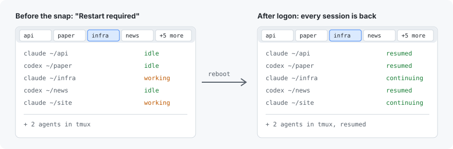

<div align="center">

# anti-thanos

**Reboot Windows. Your Claude Code and Codex sessions come back.**

[English](README.md) · [中文](README.zh-CN.md)



</div>

Thanos snaps his fingers and half of all life turns to dust. Windows restarts, and every AI conversation in your terminal turns to dust with it.

anti-thanos records each session before the restart and brings it back after you log in: the same tabs, the same titles, the same conversations. Agents that were mid-task pick up where they stopped. A snap shouldn't make you forget the ones you loved, or the work you did.

> A snap is not the end. Neither is a reboot.

## The problem

Windows says **"Restart required."** A GPU driver, a Windows update, or an installer that hung.

You have ten Windows Terminal tabs open. Each runs a Claude Code or Codex session in WSL, in its own project directory. You renamed the tabs so you can find them. Two agents are halfway through a task.

When the machine comes back, all of that is gone:

- Windows Terminal opens one empty tab.
- You don't remember which session ran in which directory, under which account, with which flags.
- You hunt through `claude --resume` and `codex resume` pickers one by one.
- The two busy agents don't know they were cut off. They wait for you, or they act as if nothing happened.
- A first `codex` run at boot quits on its own because your proxy isn't up yet.

So you postpone the restart for a day, then a week.

## The fix

```bash
anti-thanos reboot
```

It records every live agent session, stops them cleanly, and restarts Windows. After you log in, it rebuilds the window:

| | |
|---|---|
| **Same tabs** | Same order, the same titles you set by hand, the same tab selected, maximized if it was |
| **Same sessions** | Each tab resumes its own conversation in its own directory, with full history on screen |
| **Same launch** | Your original flags and the environment your wrapper set (config dir, proxy, model…). Optional rules map to your own launcher functions |
| **Interrupted work continues** | Agents that were mid-task get one message: "you were stopped by a reboot, check what finished, then continue" |
| **Background agents** | Sessions running inside tmux come back in the same tmux session |
| **The agent that rebooted reports back** | If an agent ran the reboot, it resumes, runs `anti-thanos verify`, and tells you what came back |

The hook runs once, at your next logon, and then deletes itself.

## Quick start

Run inside WSL. You need Windows Terminal, Python 3.9+, and WSL interop (on by default).

```bash
curl -fsSL https://raw.githubusercontent.com/NeoFantom/anti-thanos/main/anti-thanos -o ~/.local/bin/anti-thanos
chmod +x ~/.local/bin/anti-thanos

anti-thanos snapshot   # see which tab maps to which session, and the command each will run
anti-thanos preview    # optional: opens a throwaway window that shows the plan per tab
anti-thanos reboot     # snapshot, arm the hook, stop agents, restart in 20s
```

To cancel during the countdown, run `shutdown /a` in Windows, then `anti-thanos disarm`.

### Wait for an installer, then reboot

This tool exists because of a GPU driver install that froze after it finished. The installer process stayed alive, with no CPU and no disk activity, for an hour and a half:

```bash
anti-thanos reboot --wait-process setup.exe --stall-minutes 20
```

It waits until `setup.exe` exits, or until it has used no CPU for 20 minutes. Then it reboots.

### Let your agent do it

Paste this into the Claude Code or Codex session you are already in:

> Windows needs a restart. Use `anti-thanos` (https://github.com/NeoFantom/anti-thanos): run `anti-thanos snapshot` and show me the table first. If every session is mapped, run `anti-thanos reboot`. After the reboot you'll be resumed. Run `anti-thanos verify` and report.

## Commands

| Command | What it does |
|---|---|
| `snapshot` | Record sessions and tab layout, then print the plan. Changes nothing |
| `preview` | Open a new window with one tab per planned tab. Each tab prints what it would run. Nothing resumes |
| `arm` | `snapshot` plus installing the one-shot logon hook. Does not reboot |
| `disarm` | Remove the hook |
| `reboot` | Optional `--wait-process` wait, then `arm`, stop agents, `shutdown /r` |
| `verify` | After logon: check every recorded session is running again |
| `status` | Hook state, last snapshot, last restore log |

Use `--no-screen` to skip reading tab contents. Mapping then relies on creation order only. It is faster, but wrong if you've dragged tabs.

## How it works

1. **Find the sessions.** It scans `/proc` for interactive `claude` and `codex` processes. Claude Code's session id comes from `<config dir>/sessions/<pid>.json`. Codex's comes from the rollout file it holds open. The `WT_SESSION` and `TMUX` variables tell it which container each process lives in.
2. **Find the tabs.** PowerShell UI Automation reads each Windows Terminal window: tab titles, which tab is selected, window state, and the visible text of each tab.
3. **Match them.** Each tab's on-screen text is scored against each session's transcript. Matches are then aligned with the order the tabs were created, so the result stays right when you have plain-shell or PowerShell tabs in between, or tabs you've dragged.
4. **Write the plan.** Each tab gets a small script. It waits until the agent's API is reachable through the session's own proxy settings. Then it runs your launcher, retries if the agent quits within seconds, and drops you into your normal shell if you exit.
5. **Restore at logon.** A `.cmd` file in your Startup folder runs once. It calls `wt.exe` with one `new-tab` per tab, in order, with titles pinned, then focuses the tab you had selected.

## Configuration (optional)

Most people need none. If you start agents through shell functions, e.g. one per account, map sessions back to them. Put this in `~/.config/anti-thanos/config.json`:

```json
{
  "rules": [
    { "match": { "kind": "claude", "env": { "CLAUDE_CONFIG_DIR": "~/.claude-work" } }, "command": "claude-work --resume {id}" },
    { "match": { "kind": "codex" }, "command": "cx resume {id}" }
  ]
}
```

All keys are in [`config.example.json`](config.example.json). They cover the continue prompt, network checks, retries, title pinning, and the WT profile.

## Privacy and safety

- Everything stays on your machine. No network calls except the reachability check before each resume.
- Environment variables named like keys, tokens, secrets or passwords are never written down. Only variables your wrapper changed compared with a fresh shell are kept: config dir, proxies, model, timezone.
- `snapshot` and `preview` don't touch your sessions. `preview` only opens a new window. Only `reboot` stops anything, and it sends `SIGTERM` first so transcripts are flushed.

## Limitations (v0.1)

- Windows Terminal plus WSL only. Agents running natively in PowerShell, in VS Code terminals or over SSH are skipped.
- One pane per tab. Split panes come back as the first pane's session.
- Mapping uses screen text. Two tabs showing nearly identical screens can be swapped. Check the `snapshot` table before you reboot.
- A session that never sent a message has no transcript, so it can't be resumed. It comes back as a fresh session.
- Restore runs after you log in, not at the lock screen.

## Born from a real reboot

The first version was a one-off script, written while a GPU driver installer hung. It brought back ten agent tabs and two tmux agents. Three things broke, and they are now handled:

- Codex quit at boot because the local proxy wasn't up yet. Fix: wait for the network, retry quick exits.
- A wrong quoting layer between `wsl.exe` and the shell left the tmux restore stuck at an interactive prompt. Fix: per-tab script files, no nested shell strings.
- Typing a fix into a tab failed because the Chinese IME turned the letters into characters. Fix: never type into terminals; generate scripts instead.

Issues and PRs are welcome. The next improvements will come from real use.

## License

MIT
