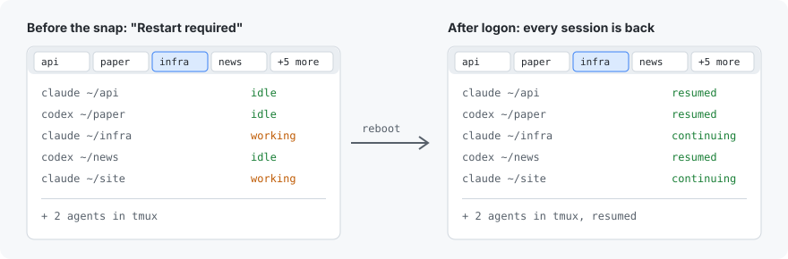

<div align="center">

# anti-thanos

**反灭霸：重启 Windows，你的 Claude Code / Codex 对话原样回来。**

[English](README.md) · [中文](README.zh-CN.md)



</div>

灭霸打一个响指，一半的生命灰飞烟灭。Windows 重启一次，你终端里所有的 AI 对话也灰飞烟灭。

anti-thanos 在重启前记下每一个对话，在你登录后把它们原样带回来：同样的标签页、同样的标题、同样的对话，干到一半的 agent 接着干。一次响指，不该让你忘记自己爱过的人和做过的工作。

> 响指不是毁灭，重启也不能是。

## 痛点

Windows 提示：**需要重启**。可能是显卡驱动、系统更新，或者一个卡死的安装程序。

你开着十个 Windows Terminal 标签页，每个都在 WSL 里跑着 Claude Code 或 Codex，各在自己的项目目录。标签页你都手动改了名，方便找。其中两个 agent 正干到一半。

重启回来，这些全没了：

- Windows Terminal 只打开一个空标签页。
- 哪个会话在哪个目录、用哪个账号、带什么参数，你记不清。
- 只能在 `claude --resume` 和 `codex resume` 的列表里一个个翻。
- 干到一半的 agent 不知道自己被打断了：要么傻等你，要么当什么都没发生。
- 开机后第一次运行 `codex`，因为代理还没起来，直接退出。

于是重启拖一天，再拖一周。

## 解决

```bash
anti-thanos reboot
```

它记下所有活着的 agent 会话，体面地停掉它们，然后重启 Windows。你登录后，它把窗口重建出来：

| | |
|---|---|
| **标签页一样** | 顺序、你手动起的标题、选中的那个都一样；原来最大化的仍然最大化 |
| **会话一样** | 每个标签页在原目录恢复原来的对话，历史完整显示 |
| **启动方式一样** | 用原来的参数和 wrapper 设的环境变量（配置目录、代理、模型等）；也可以按规则映射到你自己的启动函数 |
| **被打断的继续干** | 重启时正在干活的 agent 会收到一句话：「你被重启打断了，先核对完成到哪一步，再继续」 |
| **后台 agent** | 跑在 tmux 里的会话，恢复到同名 tmux 会话 |
| **执行重启的 agent 自己汇报** | 如果是某个 agent 执行的重启，它恢复后会运行 `anti-thanos verify`，告诉你恢复了哪些 |

开机钩子只在下次登录时运行一次，然后自删。

## 快速开始

在 WSL 里运行。需要 Windows Terminal、Python 3.9+，以及 WSL interop（默认开启）。

```bash
curl -fsSL https://raw.githubusercontent.com/NeoFantom/anti-thanos/main/anti-thanos -o ~/.local/bin/anti-thanos
chmod +x ~/.local/bin/anti-thanos

anti-thanos snapshot   # 看每个标签页对应哪个会话、各自将运行什么命令
anti-thanos preview    # 可选：开一个临时窗口，逐个标签页展示计划
anti-thanos reboot     # 快照 → 装钩子 → 停 agent → 20 秒后重启
```

倒计时内想取消：在 Windows 里运行 `shutdown /a`，再运行 `anti-thanos disarm`。

### 等安装程序结束再重启

这个工具就是这么来的：显卡驱动装完后安装程序卡住了，进程一直不退出，一个半小时里 CPU 和磁盘都没动静。

```bash
anti-thanos reboot --wait-process setup.exe --stall-minutes 20
```

等到 `setup.exe` 退出，或者它连续 20 分钟没用 CPU，就重启。

### 让 agent 替你做

把这段话贴进你正在用的 Claude Code / Codex 会话：

> Windows 需要重启。用 `anti-thanos`（https://github.com/NeoFantom/anti-thanos）：先运行 `anti-thanos snapshot` 给我看对应表。如果每个会话都对上了，就运行 `anti-thanos reboot`。重启后你会被恢复，届时运行 `anti-thanos verify` 并向我汇报。

## 命令

| 命令 | 作用 |
|---|---|
| `snapshot` | 记录会话和标签页布局，打印计划，不做任何改动 |
| `preview` | 开一个新窗口，每个计划中的标签页对应一个 tab，只打印将运行的命令，不恢复任何会话 |
| `arm` | 快照，并装上一次性的开机钩子，不重启 |
| `disarm` | 卸下钩子 |
| `reboot` | （可选：先用 `--wait-process` 等待）→ `arm` → 停 agent → `shutdown /r` |
| `verify` | 登录后：核对记录的每个会话是否都在运行 |
| `status` | 钩子状态、最近一次快照、最近一次恢复日志 |

加 `--no-screen` 可以不读标签页内容，只按创建顺序对应。这样更快，但如果拖动过标签页，就会对错。

## 原理

1. **找会话**：扫描 `/proc` 里交互式的 `claude` 和 `codex` 进程。Claude Code 的会话 ID 读自 `<配置目录>/sessions/<pid>.json`，Codex 的读自它打开的 rollout 文件。用 `WT_SESSION` 和 `TMUX` 变量判断每个进程在哪个容器里。
2. **找标签页**：用 PowerShell UI Automation 读取每个 Windows Terminal 窗口：标签页标题、选中的是哪个、窗口状态，以及每个标签页的可见文字。
3. **对应**：把每个标签页屏幕上的文字和每个会话的 transcript 打分匹配，再按标签页的创建顺序对齐。这样中间夹着普通 shell 或 PowerShell 标签页，或者拖动过顺序，也能对上。
4. **生成计划**：每个标签页一个小脚本。先通过该会话自己的代理设置等 agent 的 API 能连通；再用你的启动方式运行 agent；如果几秒内就退出则重试；你退出 agent 后回到正常 shell。
5. **登录时恢复**：Startup 文件夹里的 `.cmd` 只运行一次：调用 `wt.exe`，按原顺序每个标签页一个 `new-tab`，钉住标题，最后聚焦到原来选中的那个。

## 配置（可选）

大多数人不需要配置。如果你用 shell 函数启动 agent（比如一个账号一个函数），可以把会话映射回这些函数。写在 `~/.config/anti-thanos/config.json`：

```json
{
  "rules": [
    { "match": { "kind": "claude", "env": { "CLAUDE_CONFIG_DIR": "~/.claude-work" } }, "command": "claude-work --resume {id}" },
    { "match": { "kind": "codex" }, "command": "cx resume {id}" }
  ]
}
```

全部配置项见 [`config.example.json`](config.example.json)，包括续接提示语、联网检查、重试、标题钉选和 WT profile。

## 隐私与安全

- 一切都在本机。唯一的网络请求，是恢复前检查 agent 的 API 能否连通。
- 名字像 key、token、secret、password 的环境变量一律不落盘。只保存 wrapper 相对于新开 shell 改动过的变量：配置目录、代理、模型、时区。
- `snapshot` 和 `preview` 不碰你的会话，`preview` 只会开一个新窗口。只有 `reboot` 会停进程，而且先发 `SIGTERM`，让 transcript 落盘。

## 局限（v0.1）

- 只支持 Windows Terminal + WSL。直接跑在 PowerShell、VS Code 终端或 SSH 里的 agent 会被跳过。
- 每个标签页按一个窗格处理。分屏的标签页只恢复第一个窗格的会话。
- 对应关系依赖屏幕文字。如果两个标签页的屏幕几乎一样，可能互换。重启前请看一眼 `snapshot` 的表。
- 从没发过消息的会话没有 transcript，无法恢复，会开一个新会话代替。
- 恢复在你登录后才发生，锁屏界面不会恢复。

## 来自一次真实的重启

第一版是一次性脚本，写于一个显卡驱动安装程序卡住的时候。它恢复了十个 agent 标签页和两个 tmux 后台 agent。过程中出了三个问题，现在都已处理：

- 开机时本地代理还没起来，codex 启动即退出。对策：先等网络，启动后很快退出就重试。
- `wsl.exe` 和 shell 之间多套了一层引号，tmux 的恢复卡在交互提示符。对策：每个标签页生成独立脚本文件，不再嵌套 shell 字符串。
- 往标签页里敲命令补救时，中文输入法把字母变成了汉字。对策：永远不往终端里打字，只生成脚本。

欢迎提 Issue 和 PR。下一步的改进会来自实际使用。

## 许可

MIT
